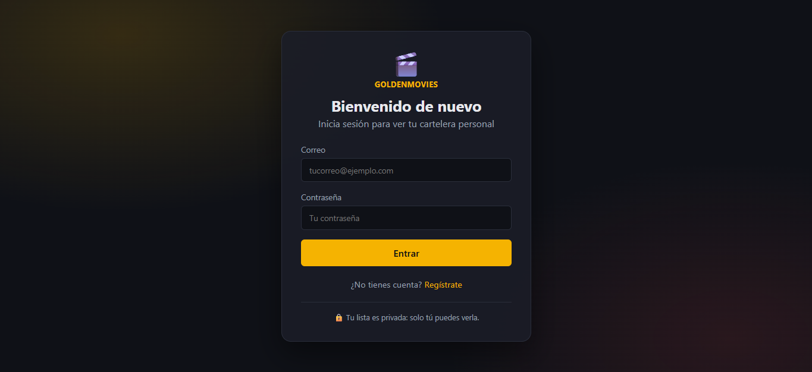
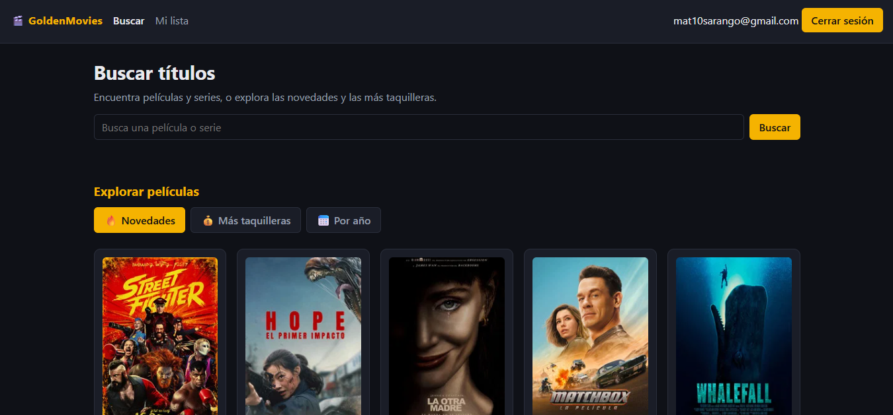
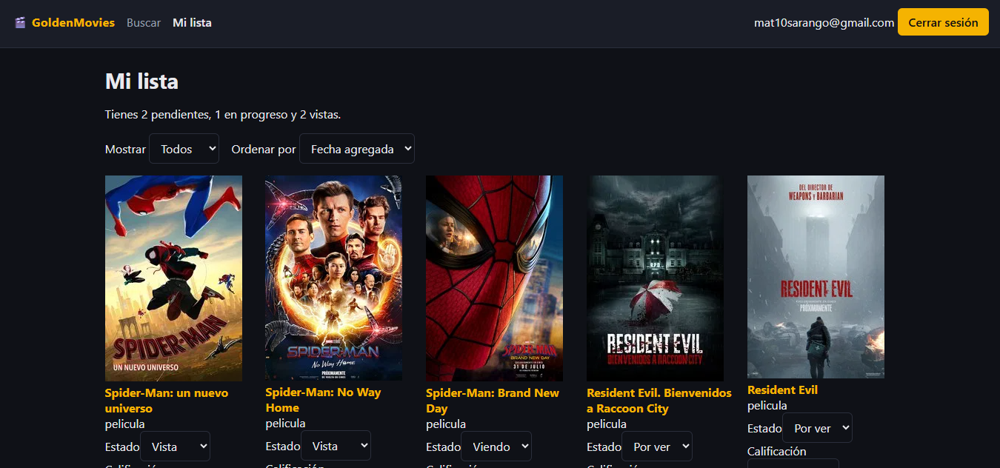
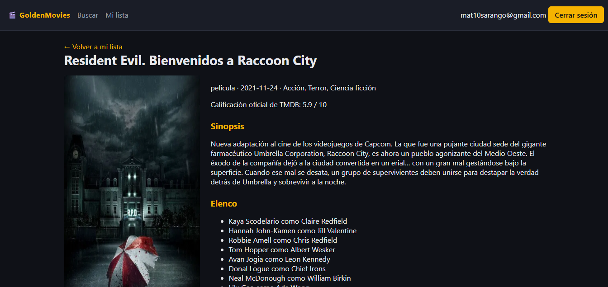

# GoldenMovies

GoldenMovies es una aplicación web donde cada usuario registra, organiza y califica las películas y series que quiere ver, está viendo o ya vio. Busca títulos reales en la API de [TMDB](https://www.themoviedb.org) y guarda su colección personal en una base de datos de Supabase, protegida por autenticación y políticas RLS.

## Funcionalidades

- Registro, inicio y cierre de sesión con Supabase Auth.
- Ninguna pantalla es visible sin sesión iniciada.
- Búsqueda de películas y series en TMDB (póster, título y año), con estados de carga y error.
- Agregar títulos a una lista personal.
- Editar el estado (por ver, viendo, vista), la calificación personal (1 a 5) y el comentario.
- Eliminar títulos de la lista.
- Página de detalle con póster grande, sinopsis, géneros, elenco, calificación de TMDB y mi opinión.
- Contador resumen, filtro por estado y orden por fecha o calificación.
- Seguridad real con Row Level Security: cada usuario solo accede a sus propios datos.

## Tecnologías

| Capa | Tecnología |
| --- | --- |
| Frontend | React + TypeScript (Vite) |
| Rutas | React Router |
| API externa | TMDB |
| Autenticación | Supabase Auth |
| Base de datos | Supabase (PostgreSQL) con RLS |

## Instalación

1. Clona el repositorio e instala las dependencias:

```bash
   git clone https://github.com/mat10sarango-afk/mi-cartelera.git
   cd mi-cartelera
   npm install
```

   (Con pnpm: `pnpm install`.)

2. Crea un archivo `.env.local` en la raíz copiando `.env.example` y completa las variables:

```
   VITE_SUPABASE_URL=https://TU_PROYECTO.supabase.co
   VITE_SUPABASE_ANON_KEY=tu_clave_publica_de_supabase
   VITE_TMDB_API_KEY=tu_api_key_de_tmdb
```

   - La URL y la clave pública de Supabase están en el panel de tu proyecto.
   - La API key (v3) se solicita en la configuración de tu cuenta de TMDB.

3. Crea la tabla y las políticas en el SQL Editor de Supabase:

```sql
   create table mi_lista (
     id bigint generated always as identity primary key,
     user_id uuid not null references auth.users(id) on delete cascade default auth.uid(),
     tmdb_id integer not null,
     titulo text not null,
     poster_url text,
     tipo_contenido text not null check (tipo_contenido in ('pelicula','serie')),
     estado text not null default 'por_ver' check (estado in ('por_ver','viendo','vista')),
     calificacion_personal integer check (calificacion_personal between 1 and 5),
     comentario text,
     fecha_agregado timestamptz not null default now(),
     unique (user_id, tmdb_id, tipo_contenido)
   );

   alter table mi_lista enable row level security;

   create policy "ver propios" on mi_lista
     for select using (auth.uid() = user_id);
   create policy "insertar propios" on mi_lista
     for insert with check (auth.uid() = user_id);
   create policy "editar propios" on mi_lista
     for update using (auth.uid() = user_id) with check (auth.uid() = user_id);
   create policy "borrar propios" on mi_lista
     for delete using (auth.uid() = user_id);
````

4. Inicia la app:

```bash
   npm run dev
```

   Abre la dirección que muestre la terminal (normalmente `http://localhost:5173`).

## Seguridad

- Las claves se leen de variables de entorno y `.env.local` está en `.gitignore`.
- La clave pública de Supabase es segura en el frontend porque el acceso a los datos lo controlan las políticas RLS. Nunca se usa la `service_role` en la app.
- Se probó con dos cuentas distintas que cada usuario solo ve, edita y elimina sus propios títulos.

## Capturas de pantalla

### Inicio de sesión


### Búsqueda en TMDB


### Mi lista


### Detalle de un título


## Enlace a la app publicada

(Pendiente: se añadirá al publicar en Vercel.)

## Créditos

Este producto usa la API de TMDB pero no está respaldado ni certificado por TMDB.
````
